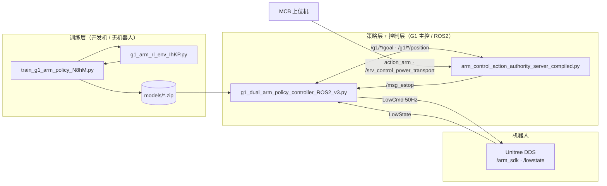
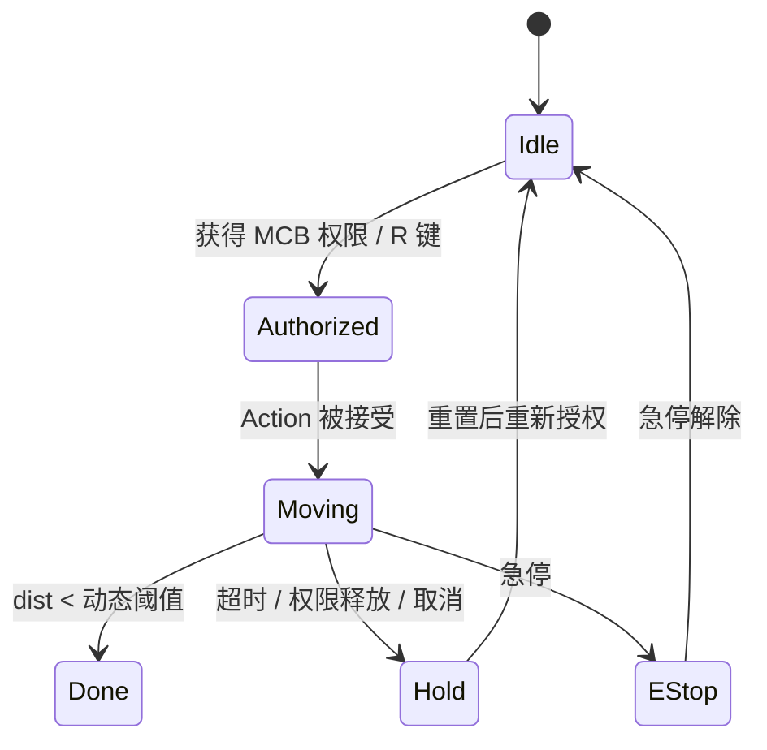

# Unitree G1 双臂强化学习控制系统

> **G1 Arm RL Control** — 基于 MuJoCo + PPO + ROS2 Humble 的 Unitree G1 人形机器人双臂到达控制，
> 打通「强化学习训练 → MuJoCo 仿真验证 → ROS2 实机下控 → MCB 上位机交互」的完整链路。

面向**搬运快递箱**作业：给定左右手目标三维笛卡尔坐标，强化学习策略输出关节增量，把双臂送到目标位置，
同时保持「拍手姿势」——掌心朝身体侧方、手掌平面垂直于地面。

---

## 目录

- [1. 项目简介](#1-项目简介)
- [2. 仓库结构](#2-仓库结构)
- [3. 环境要求](#3-环境要求)
- [4. 快速开始](#4-快速开始)
- [5. 算法设计](#5-算法设计)
- [6. 接口与通信协议](#6-接口与通信协议)
- [7. 模型清单](#7-模型清单)
- [8. 安全设计](#8-安全设计)
- [9. 关键常量速查](#9-关键常量速查)
- [10. 已知问题与注意事项](#10-已知问题与注意事项)
- [11. 文档索引](#11-文档索引)
- [12. 常见问题 FAQ](#12-常见问题-faq)
- [13. 作者](#13-作者)

---

## 1. 项目简介

系统分为四层，各层在物理上运行于不同节点：

| 层 | 职责 | 关键文件 |
|---|---|---|
| **训练层** | MuJoCo 仿真环境 + PPO/SAC/TD3 训练 + 模型导出 | `g1_arm_rl_env_IhKP.py`、`train_g1_arm_policy_N8hM.py` |
| **策略层** | 加载训练模型，把目标坐标映射为关节增量，含真实状态同步与镜像处理 | `g1_dual_arm_policy_controller_ROS2_v3.py` |
| **控制层** | ROS2 Action Server：目标校验、超时、权限门控、急停 | `arm_control_action_authority_server_compiled.py` |
| **协议/交互层** | MCB 上位机与控制器之间的 ROS2 接口、预设动作点 | `robot_interfaces`、`Arm_control_protocol_v1.0.md`、`action_points_config.py` |



一句话概括三者关系：**训练脚本负责学会「怎么安全接近目标」，验证脚本负责确认「策略是否稳定」，统一服务器负责把「策略动作」变成「受权限和急停保护的实机动作」。**

---

## 2. 仓库结构

```
arm_controller_backup_20260805/
├── README.md                                  # 本文档
├── README_202609.md                           # 项目总览：架构 / 训练 / 验证 / 协议 / 安全（四层视角）
├── arm_controller_Readme_CV.md                # 源码驱动技术文档：逐文件、逐行号的技术细节
├── arm_controller_interview_cheat_sheet.md    # 面试 Cheat Sheet：方案选型、对比、异常处理问答
├── 姿态约束详解_拍手姿势.md                     # 「拍手姿势」姿态约束的数学推导与调参指南
│
├── train_g1_arm_policy.py                     # 训练入口（早期环境 g1_arm_rl_env）
├── train_g1_arm_policy_N8hM.py                # 训练入口（拍手约束环境 g1_arm_rl_env_IhKP）★实际使用
├── g1_arm_rl_env.py                           # 训练环境（早期版，无姿态约束；提供 DISTANCE_THRESHOLD）
├── g1_arm_rl_env_IhKP.py                      # 训练环境（拍手约束版）★实际使用
├── g1_arm_rl_env_left.py                      # 左臂环境变体
├── g1_arm_policy_controller.py                # 单臂验证 / 实机输出控制器（SDK2 直连）
├── g1_dual_arm_policy_controller.py           # 双臂验证控制器（SDK2 直连）
├── g1_point_path.xml                          # 单点轨迹的 MuJoCo 场景
│
├── models/                                    # 训练产物（多轮实验，详见第 7 节）
├── runs/g1_arm_reach/                         # TensorBoard 日志（每次训练一个 run 目录）
├── backup_script/                             # 2025-09/10 历史备份脚本（废弃，仅存档）
├── unitree_mujoco/                            # MuJoCo 机器人模型资源（XML + 网格）
├── unitree_sdk2_python/                       # Unitree SDK2 Python 绑定（第三方）
├── src/                                       # ROS2 工作空间源码 ★推荐作为 colcon build 根
│   ├── robot_interfaces/                      # Action / Service / Msg 接口定义包
│   ├── arm_controller/                        # arm_controller ROS2 包（代码 + 部署文档）
│   └── config/actionpoints.yaml               # 预设动作点
│
└── RL_arm_controler_V4.1_..._Estop&_Authority/ # 交付快照（内容与 src/ 一致，便于整体拷贝）
    └── arm_controller/
        ├── package.xml / setup.py / requirements.txt / environment.yml
        ├── launch/                            # start_dual_arm_controller.sh、dual_arm_control.launch.py
        ├── models/ · unitree_mujoco/          # 部署用模型与 XML
        └── arm_controller/                    # 包源码（与 src/arm_controller/arm_controller 相同）
```

> **⚠️ 关于两份 `arm_controller`**
> 仓库中 `src/arm_controller/` 与 `RL_arm_controler_V4.1_.../arm_controller/` 是**同一份代码的两份拷贝**：
> 前者是 ROS2 工作空间的标准位置（`colcon build` 使用），后者是可直接整体拷给交付方的快照。
> 修改代码请只改一处，或明确以 `src/` 为准。

> **📦 大文件说明**：`RL_ARM_Controller_for Handover to Sunny - 202609.zip`（124 MB）使用 **Git LFS** 托管。
> 克隆后需执行 `git lfs pull` 才能拿到真实文件，否则只有一个几百字节的指针。

---

## 3. 环境要求

| 组件 | 版本 / 说明 |
|---|---|
| 操作系统 | Ubuntu 22.04 LTS |
| ROS2 | **Humble** |
| Python | **3.10**（conda 环境名 `g1_vibe`） |
| 仿真引擎 | MuJoCo **3.3.5**（`mujoco>=3.0.0`） |
| 强化学习 | stable-baselines3 **2.7.0**、gymnasium **1.2.0**、torch **2.8.0**（CUDA 12.8） |
| 机器人通信 | CycloneDDS（`rmw_cyclonedds_cpp`）、`unitree-sdk2py` **1.0.1** + `unitree_ros2` 工作空间 |
| 硬件 | Unitree G1（29 DoF，带手），控制网卡以实际为准（如 `ens37`） |

```bash
# 依赖安装（conda）
conda create -n g1_vibe python=3.10 -y
conda activate g1_vibe
pip install stable-baselines3==2.7.0 "mujoco>=3.0.0" "gymnasium>=1.0.0"
pip install -e ./unitree_sdk2_python        # 或参考 https://github.com/unitreerobotics/unitree_sdk2_python
```

完整环境可用 `RL_arm_controler_V4.1_.../arm_controller/environment.yml` / `requirements.txt` 复现。

---

## 4. 快速开始

### 4.1 获取代码

```bash
git clone https://github.com/Can-Guo/G1_arm_RL_control.git
cd G1_arm_RL_control
git lfs pull          # 拉取 124 MB 的交付 zip（可选）
```

### 4.2 训练（开发机，无机器人）

```bash
# 左臂策略（默认）
python train_g1_arm_policy_N8hM.py --algo ppo --total-steps 50000000 --num-envs 16 --checkpoint 250000

# 右臂策略
python train_g1_arm_policy_N8hM.py --algo ppo --right-arm --total-steps 50000000 --num-envs 16 --checkpoint 250000

# 断点续训
python train_g1_arm_policy_N8hM.py --algo ppo --resume-from models/xxx/ppo_g1_left_5000k.zip

# 监控
tensorboard --logdir runs/g1_arm_reach
```

| 参数 | 默认值 | 说明 |
|---|---|---|
| `--algo` | `ppo` | 可选 `ppo` / `sac` / `td3` |
| `--total-steps` | `50_000_000` | 总环境步数 |
| `--num-envs` | `16` | DummyVecEnv 并行环境数（历史实验用过 256） |
| `--checkpoint` | `250_000` | 分段保存间隔 |
| `--right-arm` | 关闭 | 训练右臂而非左臂 |
| `--headless` | 关闭 | 无显示器时关闭 MuJoCo viewer |
| `--resume-from` | — | 从 checkpoint 续训 |

> `train_g1_arm_policy.py` 导入的是**早期环境** `g1_arm_rl_env`（无姿态约束）；
> `train_g1_arm_policy_N8hM.py` 导入的是**拍手约束环境** `g1_arm_rl_env_IhKP`（第 55 行）。
> 复现存档实验请使用 `_N8hM` 版本。

### 4.3 仿真验证（无机器人）

```bash
# 单臂验证：键盘微调目标，观察末端是否平滑到达
python g1_arm_policy_controller.py --model models/ppo_left_5M_Feb09/20260209-12310-lArm/ppo_g1_left_5000k.zip --sim-only true
python g1_arm_policy_controller.py --model models/ppo_right_5M_Aug28/ppo_g1_right_5000k.zip --sim-only true

# 双臂验证（SDK2 直连版）
python g1_dual_arm_policy_controller.py
```

键盘（单臂/双臂手动模式）：

| 按键 | 作用 |
|---|---|
| `W` `S` / `A` `D` / `Q` `E` | 左臂 X 前进后退 / Y 左右 / Z 升降 |
| `I` `K` / `J` `L` / `U` `O` | 右臂 X 前进后退 / Y 左右 / Z 升降 |
| `R` | 切换机器人输出（仿真 → 实机，谨慎开启） |
| `T` | 切换仿真输出 |
| `M` | 切换手动 / Action 模式 |

验证时重点看：到达时间是否稳定、轨迹是否平滑、末端距离是否单调下降、姿态是否翻腕、是否贴近躯干。

### 4.4 实机部署（2 终端架构）

```bash
# 公共前置（每个终端都要执行）
conda activate g1_vibe
cd ~/RL_arm_control
colcon build --packages-select robot_interfaces arm_controller --symlink-install   # 首次
source /opt/ros/humble/setup.bash
source install/setup.bash
source <unitree_ros2>/setup_ros2_env.sh           # CycloneDDS + ROS_DOMAIN_ID
```

> `unitree_ros2` 环境脚本来自 Unitree 官方工作空间，**本仓库未内置**（`src/pkg/unitree_ros2` 为空目录），
> 需按部署环境自行获取；若 MCB 环境已配置 DDS，可跳过该行。

```bash
# 终端 1 —— 策略控制器（发布 /arm_sdk，订阅 /lowstate）
ros2 run arm_controller dual_arm_controller

# 终端 2 —— 统一服务器（Action + 权限 + 急停）
ros2 run arm_controller arm_action_authority_server

# 终端 3 —— 可选：测试客户端 / MCB 上位机
ros2 run arm_controller arm_test_client
```

一键启动脚本：`src/arm_controller/launch/start_dual_arm_controller.sh`。

### 4.5 安装自检

```bash
ros2 pkg list | grep arm_controller
ros2 pkg executables arm_controller
ros2 interface list | grep ArmControl
python3 -c "from arm_controller import DISTANCE_THRESHOLD; print('OK', DISTANCE_THRESHOLD)"
```

---

## 5. 算法设计

### 5.1 问题建模（MDP）

每臂独立建模为到达任务，采用**增量关节控制 + 末端笛卡尔目标**（策略不直接输出末端坐标）：

| 项目 | 定义 |
|---|---|
| 观测（24 维） | `concat[ q(7), dq(7), p_hand(3), p_goal(3), Δp(3), step_frac(1) ]` |
| 动作（7 维） | `Box(-0.05, 0.05, shape=(7,))`，即每个关节的**角度增量**（rad），积分后 clip 到 ±π |
| 成功判据 | `‖p_goal − p_hand‖ < 0.03 m` |
| 单回合上限 | 训练 200 步 / 部署 500 步 |
| 未训练侧手臂 | 固定在安全 rest pose，降低干扰与自碰撞 |

增量式动作 ≤ 0.05 rad/步，让策略输出天然平滑、幅度有界，便于实机安全执行。

### 5.2 奖励函数

```python
reward  = -5.0 * dist                      # 距离项（主导）
          - 0.1 * ‖action‖                 # 动作平滑
          - 2.0 * (1 - lateral_alignment)² # 掌心侧向对齐（拍手姿势核心）
          - 1.5 * |palm_normal[2]|         # 手掌平面垂直
          - 0.5 * |grasp_axis[2]|          # 手指方向自然性
          - 200.0 - 2000.0 * penetration   # 碰撞惩罚（penetration < 0.002 m 时不罚）
          - (0.10 - d_torso) * 100.0       # 躯干邻近惩罚（d_torso < 0.10 m 时）
          + 1.0                            # 成功奖励（稀疏）
```

设计顺序即调参顺序：**先奖励「朝目标靠近」→ 再奖励「动作轻」→ 然后「姿态稳」→ 最后严禁「撞身体」**。

### 5.3 拍手姿势约束

旧约束要求「抓握轴竖直 + 手掌平面水平」，几何上只能得到"手心朝上/朝下"。
新约束改为从**掌心法向量**（旋转矩阵 `ori_mat[:, 1]`）直接判定朝向：

| 约束 | 数学形式 | 权重 | 期望 |
|---|---|---|---|
| 掌心侧向对齐 | `lateral = palm_normal[1]`（右臂取负），`r -= 2.0*(1-lateral)²` | 2.0 | 左臂掌心朝 +Y，右臂朝 −Y |
| 手掌平面垂直 | ``r -= 1.5*\|palm_normal[2]\|`` | 1.5 | 掌心法向水平（平行地面方向） |
| 手指方向自然 | ``r -= 0.5*\|grasp_axis[2]\|`` | 0.5 | 抓握轴大致水平 |

平方损失的作用：接近目标时梯度小可微调，偏离时梯度大快速纠正。
实现位置：`g1_arm_rl_env_IhKP.py`（约 605–641 行），推导详见 [`姿态约束详解_拍手姿势.md`](姿态约束详解_拍手姿势.md)。

### 5.4 目标采样

- 60% 为正面目标：右臂 `y ∈ [-0.45, -0.05]`，左臂 `y ∈ [0.05, 0.45]`；
- 可达半径 `reach_max = 0.60 m`（肩到目标的距离上限）；
- 与躯干中心 `(0, 0, 0.90)` 保持 ≥ 0.10 m 距离。

### 5.5 「防突发移动」机制

控制权转移瞬间最容易出现"机械臂猛跳"。v2 在 `g1_dual_arm_policy_controller_ROS2_v3.py`（约 839–924 行）用
`sync_real_robot_state_to_sim()` 解决：

1. 从 `/lowstate` 读真实关节角（`motor_idx` 15–28）；
2. 超过 **1.0 s** 未收到状态 → 打警告并跳过本次同步；
3. 按 `motor_idx → joint_name` 映射写回 MuJoCo `qpos`；
4. 由 `qpos` 前向计算手掌位置，作为后续策略的观测起点。

**关节索引与镜像约定（关键）**：

| 含义 | 索引 | 备注 |
|---|---|---|
| 左臂 7 关节 | 15–21 | shoulder pitch/roll/yaw、elbow、wrist roll/pitch/yaw |
| 右臂 7 关节 | 22–28 | 镜像布局 |
| 手部抓手 | 29 | 部署时 `q = 1.0`（合拢） |
| 镜像关节 | 19↔26、21↔28 | `left_wrist_roll = -right_wrist_roll`，`left_wrist_yaw = -right_wrist_yaw` |

左右臂在 XML 中对称建模，但 G1 实机关节方向相反：直接把右臂策略输出给左臂会使第 5、7 号关节方向错误，
因此下发前取反，并把被镜像的关节同步回仿真。

### 5.6 训练流程与分段保存

- PPO/SAC/TD3 可选，默认 PPO + `MlpPolicy`；
- 每 `--checkpoint`（默认 250k）步保存一次 checkpoint，按 chunk 滚动训练，支持跨天续训；
- 运行命名 `YYYYMMDD-HHMMSS-lArm` / `-rArm`，模型落 `models/<run>/`，TensorBoard 落 `runs/g1_arm_reach/<run>/`；
- `DetailedMetricsCallback` 把 `task/` `pose/` `reward/` `hand/` `goal/` `error/` `joints/` `action/` 分组指标写入 TensorBoard。

---

## 6. 接口与通信协议

### 6.1 Action：`action_arm`

类型 `robot_interfaces/action/ArmControl`（定义见 `src/robot_interfaces/action/ArmControl.action`）。

| 段 | 字段 | 类型 | 说明 |
|---|---|---|---|
| **Goal** | `target` | string | `empty_box` / `product_box` / 空 |
| | `action` | string | `pick` / `place` / `move` / 空 |
| | `x_l, y_l, z_l` | float64 | 左臂目标（m） |
| | `x_r, y_r, z_r` | float64 | 右臂目标（m） |
| | `high_resolution` | int32 | 精度模式，≥1 |
| **Feedback** | `x_l, y_l, z_l` / `x_r, y_r, z_r` | float64 | 10 Hz 当前位置 |
| **Result** | `result` | string | `success` / `failed` |
| | `error` | string | 错误信息 |
| | `x_l..z_r` | float64 | 最终位置 |

动态精度：`multiplier = max(1, high_resolution)`，即 **1 → 3 cm，2 → 6 cm，3 → 9 cm**，数值越大判定越宽松。

### 6.2 话题与服务

| 接口 | 类型 | 方向 | 说明 |
|---|---|---|---|
| `action_arm` | `robot_interfaces/action/ArmControl` | Action | 双臂目标控制 |
| `/srv_control_power_transport` | `robot_interfaces/srv/ControlPower` | Service | MCB 请求/释放控制权限（`task_id` / `object` / `type`） |
| `/msg_estop` | `robot_interfaces/msg/Estop` | Topic | 急停信号，`emergency_stop` = `'Y'` / `'N'` |
| `/g1/left_arm/goal`、`/g1/right_arm/goal` | `std_msgs/Float64MultiArray` | 服务器 → 控制器 | 左/右臂目标 `[x, y, z]` |
| `/g1/left_arm/position`、`/g1/right_arm/position` | `std_msgs/Float64MultiArray` | 控制器 → 服务器 | 当前位置反馈（10 Hz） |
| `/g1/arm/distance_threshold` | `std_msgs/Float64MultiArray` | 服务器 → 控制器 | 动态距离阈值 |
| `/arm_sdk` | `unitree_api/msg/LowCmd` | 控制器 → 机器人 | 关节下控（50 Hz，`kp=50.0`、`kd=1.5`） |
| `/lowstate` | `unitree_api/msg/LowState` | 机器人 → 控制器 | 真实关节状态（idx 15–28） |
| 控制权状态 | `std_msgs/Bool` | 服务器 → 广播 | 权限/急停状态（10 Hz） |

### 6.3 权限与急停逻辑

- 控制权限 = **本地 `R` 键使能 OR MCB 授权**（逻辑"或"）；
- **急停优先级最高**：触发即冻结机械臂、释放 MCB 权限、中止当前 Action；
- 未获授权时 Action 一律拒绝；权限释放后任务中止并停在当前位置；
- Action 超时 **10.0 s**（以最新代码为准，旧文档中的 30 s 已过时）：超时后立即发停止命令、返回 `failed`、附带当前实际位置。



### 6.4 目标校验

`_validate_goal()` 在 Action 接受前做范围校验，越界直接拒绝（不裁剪后继续执行）：

| 目标 | 允许范围（m） |
|---|---|
| 左臂 | `x ∈ [0.0, 0.6]`，`y ∈ [0.0, 0.6]`，`z ∈ [0.55, 1.45]` |
| 右臂 | `x ∈ [0.0, 0.6]`，`y ∈ [-0.6, 0.0]`，`z ∈ [0.55, 1.45]` |
| `high_resolution` | 整数且 ≥ 1 |

### 6.5 预设动作点

配置：`src/config/actionpoints.yaml`（`ActionPointsConfig` 支持多路径搜索，含 MCB 标准路径）。

| 名称 | 左臂 (x,y,z) | 右臂 (x,y,z) |
|---|---|---|
| `arm_safety` | 0.05, 0.27, 0.71 | 0.09, −0.27, 0.72 |
| `arm_home` | 0.10, 0.30, 0.75 | 0.10, −0.30, 0.75 |
| `arm_open_prepare` | 0.074, 0.445, 0.93 | 0.075, −0.45, 0.90 |
| `arm_open_prepare_for_box` | 0.30, 0.20, 0.95 | 0.30, −0.20, 0.95 |

测试客户端操作：`1–4` 跳转预设点、`P x_l y_l z_l x_r y_r z_r [精度]` 自定义、`T` 超时测试、`B` 批量测试、`H` 帮助。

---

## 7. 模型清单

`models/` 下保存了多轮训练产物，目录名即实验名（`lArm` / `rArm` 标注训练侧）：

| 目录 | 内容 | 说明 |
|---|---|---|
| `ppo_left_5M_Feb09/20260209-12310-lArm/` | `ppo_g1_left_5000k.zip`、`ppo_g1_left_final.zip` | **部署默认左臂模型** |
| `ppo_right_5M_Aug28/` | `ppo_g1_right_1000k..final.zip`（21 个） | **部署默认右臂模型** |
| `ppo_left_10M_Oct09/` | 两个 run（20251010-094318、20251010-100658），37 个 | 左臂 10M 步实验 |
| `ppo_right_10M_Oct09/` | 41 个 | 右臂 10M 步实验 |
| `20251009-183451-rArm/` | 81 个（最高 20000k） | 右臂 20M 步实验（256 并行环境，约 3400 fps） |
| `20251016-123855-lArm/` | 21 个 | 左臂短程实验 |
| `model_left_50M_20250827/` | 201 个 | 左臂 50M 步长训实验 |
| `ppo_left_5M_Sep11/` | 21 个 | 左臂早期实验 |
| `ppo_left_5M_Feb09_clapCons/` | 21 个 | 拍手约束早期版本 |
| `ppo_left_5M_Feb10_Cons01/` | 41 个 | 拍手约束调参版本 |
| `default_author/` | `ppo_g1_left_53178k.zip` | 交付用单模型 |

每个模型的训练终端记录另存为 `0_readme_*.txt`（含完整配置与 fps），可直接核对超参。

---

## 8. 安全设计

安全被拆成四层责任，任何一层缺失都不能视为"可上实机"：

1. **训练层**：动作幅度限制（±0.05 rad）、工作空间约束、姿态/躯干/碰撞惩罚、未训练侧手臂固定。
2. **服务器层**：权限门控、急停最高优先、目标范围校验、10 s 超时保护、中止保护、状态广播。
3. **客户端层**：先仿真后实机、先单臂后双臂、不绕过统一服务器直接下控、失败/超时/急停后停止追发目标。
4. **运维层**：开机确认 ROS2 / DDS / 网络；先查模型左右臂是否匹配；异常时先让系统停在当前位置再排查。

**安全优先级**：急停 → 权限撤销 → 超时停止 → 目标范围校验 → 碰撞与躯干惩罚 → 动作平滑与姿态正则。
含义很直接：**如果系统不知道下一步是否安全，最好的动作就是先不动。**

---

## 9. 关键常量速查

| 常量 | 值 | 位置 |
|---|---|---|
| `DISTANCE_THRESHOLD` | 0.03 m | `g1_arm_rl_env.py`、部署控制器、服务器兜底 |
| 动作幅度 | ±0.05 rad | 各环境 `action_space` |
| 成功判定 | `dist < 0.03 m` | 环境 `_compute_success` |
| 观测维度 | 24 | 各环境 `observation_space` |
| 训练 / 部署回合上限 | 200 / 500 步 | 环境 / 部署控制器 |
| 碰撞穿透阈值 | 0.002 m（训练）/ 0.005 m（部署） | 环境 / 部署控制器 |
| 碰撞惩罚 | `-200 - 2000×penetration` | 环境 |
| 姿态约束权重 | 2.0 / 1.5 / 0.5 | 环境（拍手约束段） |
| 躯干邻近惩罚 | `-(0.10-d_torso)*100`，躯干中心 (0,0,0.90) | 环境 |
| 可达半径 | 0.60 m | 环境目标采样 |
| Action 超时 / Feedback | 10.0 s / 10 Hz | 统一服务器 |
| LowCmd 增益 | `kp=50.0`、`kd=1.5` | 部署控制器 |
| 手部关节 | idx 29 = 1.0 | 部署控制器 |
| `/lowstate` 同步过期 | 1.0 s | 部署控制器 |
| 手动步进 / 动作速度缩放 | 0.015 m / 0.5 | 部署控制器 |
| 发布 / 下发频率 | 10 Hz / 50 Hz | 部署控制器 |

---

## 10. 已知问题与注意事项

| 问题 | 说明与建议 |
|---|---|
| **训练默认关闭碰撞** | `_DISABLE_COLLISION = True`，策略未在碰撞惩罚下训练；部署侧虽有碰撞冻结逻辑，但策略本身没学过避碰。密集作业需重新开启碰撞训练。 |
| **左右臂独立训练** | `-lArm` / `-rArm` 分别训练、部署时分别加载。`--right-arm` 目前更像"实验区分 + 路径命名"信号，二次开发需确认它真的传进环境构造函数。 |
| **超时值文档不一致** | 旧手册/测试客户端写 30 s，统一服务器代码是 10.0 s。**以代码为准**。 |
| **launch 文件指向旧服务器** | `dual_arm_control.launch.py` 启动的是旧版 `arm_action_server_compiled`（3 终端架构）；统一服务器需手动 `ros2 run arm_controller arm_action_authority_server`。 |
| **`SUNNY_README_latest.md` 已过时** | 它描述的是 v3.1 三终端架构（超时 30 s），与当前统一服务器实现不符；当前生效文档是 `control_power_&_emergency_updated_20260223.md`。 |
| **Action 名不一致** | 测试客户端默认 `/action_arm`，服务器注册名 `action_arm`，不带前缀可能匹配不上。 |
| **`--sim-only` 默认值是字符串** | `g1_arm_policy_controller.py` 中 `default="true"`（字符串而非布尔），按真值语义判断时需注意。 |
| **`__init__.py` 依赖旧环境** | 包级 `DISTANCE_THRESHOLD` 从早期 `g1_arm_rl_env` 导入；若只改 `g1_arm_rl_env_IhKP`，服务器侧阈值会不同步（当前两者都是 0.03）。 |
| **占位/缺失文件** | `dual_arm_controller_wrapper.py` 为空文件；`diagnose_authority` 只有 `.pyc` 没有源码。 |
| **两份 `arm_controller`** | `src/` 与交付快照目录内容相同，改一处即可，避免双份漂移。 |

---

## 11. 文档索引

| 文档 | 内容 |
|---|---|
| [`README_202609.md`](README_202609.md) | 项目总览：四层架构、训练/验证/控制/协议/安全，带 mermaid 图 |
| [`arm_controller_Readme_CV.md`](arm_controller_Readme_CV.md) | 源码驱动技术文档：逐文件职责、数据流、常量表、行号级引用 |
| [`arm_controller_interview_cheat_sheet.md`](arm_controller_interview_cheat_sheet.md) | 方案选型对比、为什么不用 MoveIt/MPC、重构思路、异常处理问答 |
| [`姿态约束详解_拍手姿势.md`](姿态约束详解_拍手姿势.md) | 掌心朝向约束的数学推导、几何图示、权重调参顺序 |
| [`src/arm_controller/SUNNY_README_latest.md`](src/arm_controller/SUNNY_README_latest.md) | v3.1 三终端部署手册（架构已过时，安装步骤仍可参考） |
| [`src/arm_controller/control_power_&_emergency_updated_20260223.md`](src/arm_controller/control_power_&_emergency_updated_20260223.md) | **当前生效**：权限、功率、急停与突发移动修复说明 |
| [`src/arm_controller/Arm_control_protocol_v1.0.md`](src/arm_controller/Arm_control_protocol_v1.0.md) | MCB → 机器人 的 Arm Action 协议定义 |
| [`src/arm_controller/readme_to_install_and_test.txt`](src/arm_controller/readme_to_install_and_test.txt) | 依赖安装与常见报错速查 |

---

## 12. 常见问题 FAQ

**Q：`ModuleNotFoundError: No module named 'stable_baselines3'` / `'mujoco'`**
`pip install stable-baselines3 mujoco`，并确认已 `conda activate g1_vibe`。

**Q：GLFW / EGL 报错 `could not create window`、`failed to open swrast`**
`conda install -c conda-forge libstdcxx-ng`；服务器环境请加 `--headless`。

**Q：`ros2 run arm_controller ...` 找不到可执行文件**
先 `colcon build --packages-select robot_interfaces arm_controller --symlink-install` 并 `source install/setup.bash`。

**Q：控制器连不上 / 找不到话题**
`ros2 topic list | grep arm` 检查；确认 `echo $RMW_IMPLEMENTATION` 为 `rmw_cyclonedds_cpp`、`echo $ROS_DOMAIN_ID` 为 `0`，并已 source `setup_ros2_env.sh`。

**Q：找不到模型文件**
检查 `models/` 下路径是否正确；包内通过 `ament_index_python` 的 `get_package_share_directory('arm_controller')` 解析路径，安装态与源码态都能找到。

**Q：仿真能到、实机很飘？**
依次检查：模型路径左右臂是否匹配 → 目标是否超出安全范围 → 是否误开了实机输出 → 训练/验证环境的碰撞与姿态约束是否一致。

**Q：为什么不用 MoveIt / MPC / 解析逆解？**
见 [`arm_controller_interview_cheat_sheet.md`](arm_controller_interview_cheat_sheet.md)：本项目的约束是"目标坐标直接驱动、无外部感知依赖、要在低成本主控上跑实时闭环"，学习式增量控制在这类场景里提供了更平滑的可达轨迹，代价是需要大量仿真训练与严格的安全兜底。

---

## 13. 作者

- **作者**：York GUO ｜ 邮箱：1739950387@qq.com
- **协作**：Sunny Zhu（MCB 协议与交付对接）
- 包元数据声明许可：Apache-2.0（见 `src/arm_controller/package.xml`）

---

> 建议的使用顺序：**先训练单臂 → 单臂仿真验证 → 双臂协同验证 → ROS2/MCB 交付链路 → 最后接真机。**
> 任何时候都不要把"模型学会了"误认为"系统可以直接上实机"。
