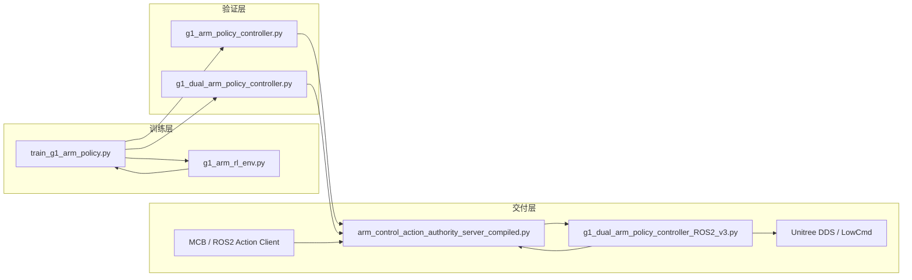
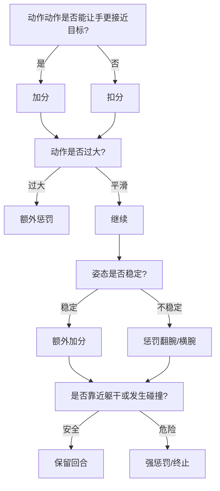
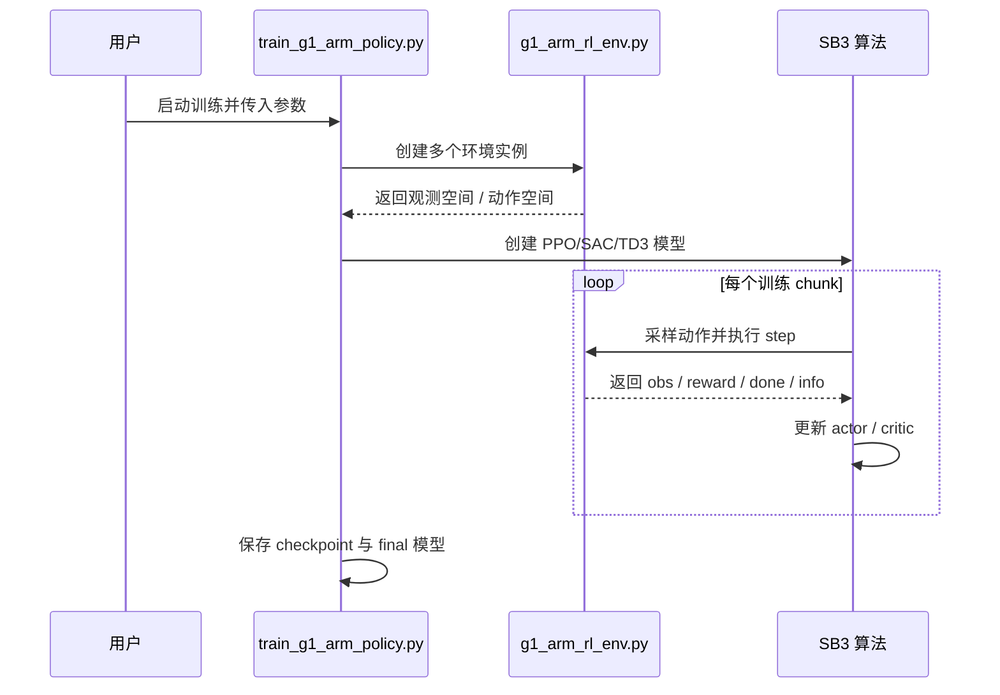
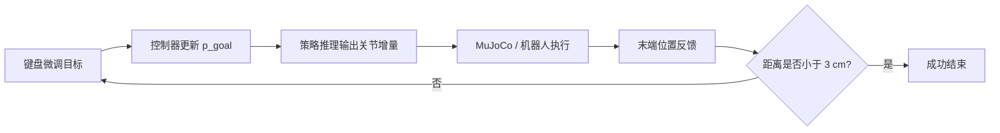
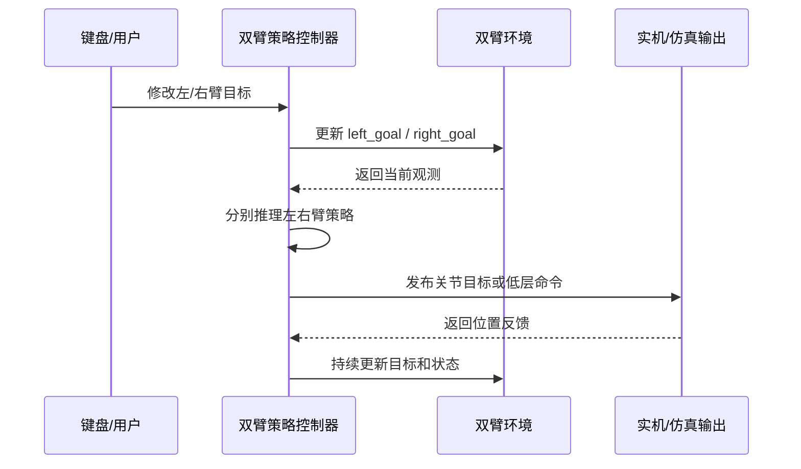
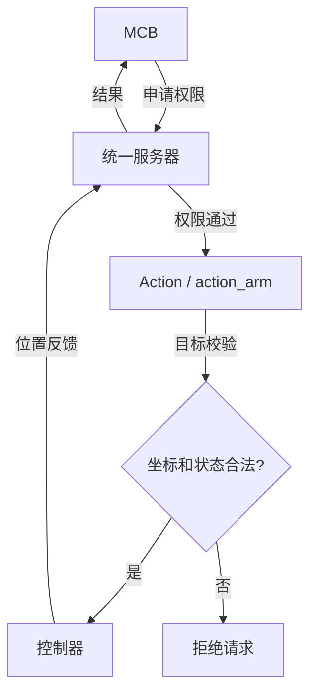
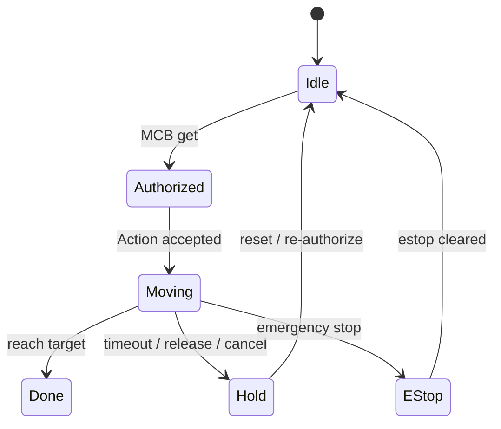

# Unitree G1 机械臂 RL 控制项目说明

本文档说明当前 RL-shenanigans 目录下最新版脚本的工作方式、使用场景、控制链路、MCB 协议以及安全边界。本文只描述当前主线版本，不包含 backup_script 目录中的历史备份分支。

本项目的核心目标是：

1. 使用强化学习训练 Unitree G1 单臂抓取与到达策略。
2. 使用训练好的策略对左臂或右臂进行仿真验证和实机验证。
3. 使用左右臂策略同时驱动双臂，完成协同控制。
4. 在交付目录中的 arm_controller 版本里，接入 MCB 控制权限、Action 协议和急停管理。
5. 把训练阶段、验证阶段和实机控制阶段统一到一套可解释、可审计、可停机的安全流程中。

## 一、当前主线文件映射

下面这些文件是当前最重要的主线入口，后续说明都基于它们：

| 角色 | 文件 |
|---|---|
| 训练入口 | [train_g1_arm_policy.py](train_g1_arm_policy.py) |
| 单臂训练环境 | [g1_arm_rl_env.py](g1_arm_rl_env.py) |
| 单臂验证与实机输出控制 | [g1_arm_policy_controller.py](g1_arm_policy_controller.py) |
| 双臂同时控制 | [g1_dual_arm_policy_controller.py](g1_dual_arm_policy_controller.py) |
| 交付版统一服务器 | [RL_arm_controler_V4.1_Updated_Feb23_One_server_Fix_sudden_move_with_Estop&_Authority/arm_controller/arm_controller/arm_control_action_authority_server_compiled.py](RL_arm_controler_V4.1_Updated_Feb23_One_server_Fix_sudden_move_with_Estop&_Authority/arm_controller/arm_controller/arm_control_action_authority_server_compiled.py) |
| 交付版 ROS2 双臂控制器 | [RL_arm_controler_V4.1_Updated_Feb23_One_server_Fix_sudden_move_with_Estop&_Authority/arm_controller/arm_controller/g1_dual_arm_policy_controller_ROS2_v3.py](RL_arm_controler_V4.1_Updated_Feb23_One_server_Fix_sudden_move_with_Estop&_Authority/arm_controller/arm_controller/g1_dual_arm_policy_controller_ROS2_v3.py) |
| MCB 协议说明 | [RL_arm_controler_V4.1_Updated_Feb23_One_server_Fix_sudden_move_with_Estop&_Authority/arm_controller/Arm_control_protocol_v1.0.md](RL_arm_controler_V4.1_Updated_Feb23_One_server_Fix_sudden_move_with_Estop&_Authority/arm_controller/Arm_control_protocol_v1.0.md) |
| 权限与急停说明 | [RL_arm_controler_V4.1_Updated_Feb23_One_server_Fix_sudden_move_with_Estop&_Authority/arm_controller/control_power_&_emergency_updated_20260223.md](RL_arm_controler_V4.1_Updated_Feb23_One_server_Fix_sudden_move_with_Estop&_Authority/arm_controller/control_power_&_emergency_updated_20260223.md) |

如果你只想看当前能直接用于 MCB 交付的部分，请优先看 arm_controller 目录下的统一服务器和 ROS2 控制器；训练脚本和训练环境负责生成策略，不承担 MCB 协议职责。

## 二、项目总体架构

本项目可以分成四层：

1. 训练层：在 MuJoCo 中训练单臂策略。
2. 策略层：使用训练好的模型完成目标到达、姿态保持和轨迹生成。
3. 控制层：把策略输出转成关节级控制，并在仿真或实机上执行。
4. 协议与安全层：用 ROS2 Action、权限服务和急停状态把 MCB、控制器和机器人串起来。

可以把整条链路理解成：

训练环境生成观测与奖励 -> PPO 学习关节增量到目标位置的映射 -> 控制器用冻结策略做实时推理 -> 统一服务器只在授权且无急停时接受指令 -> 机器人控制器把目标位置转换为低层关节命令 -> 位置反馈和结果再回传给服务器和客户端。

下面这张图可以帮助你先建立整体心智模型：

从工程角度看，这个项目不是“一个脚本完成所有事情”，而是一个分层系统：训练负责学策略，验证负责看策略是否稳定，交付层负责把策略放进权限和安全框架里。

### 2.1 代码执行链路的总原则

读这个项目时，建议你始终记住下面三条原则：

1. 环境决定训练语义，控制器决定动作如何落地，服务器决定谁有资格发动作。
2. 训练阶段追求的是“会做”，验证阶段追求的是“做得稳”，交付阶段追求的是“做得安全且可被外部系统约束”。
3. 任何时候都不要把“模型学会了”误认为“系统就可以直接上实机”。

### 2.2 代码之间的职责分工

如果从代码实现角度拆开看，每个文件的职责很明确：

1. [train_g1_arm_policy.py](train_g1_arm_policy.py) 负责创建向量化环境、选择 PPO/SAC/TD3、周期性保存模型。
2. [g1_arm_rl_env.py](g1_arm_rl_env.py) 负责定义状态、动作、奖励、终止条件和目标采样逻辑。
3. [g1_arm_policy_controller.py](g1_arm_policy_controller.py) 负责加载冻结模型、读取键盘输入、同步仿真和可选实机输出。
4. [g1_dual_arm_policy_controller.py](g1_dual_arm_policy_controller.py) 负责左右臂双策略同时推理。
5. [arm_control_action_authority_server_compiled.py](RL_arm_controler_V4.1_Updated_Feb23_One_server_Fix_sudden_move_with_Estop&_Authority/arm_controller/arm_controller/arm_control_action_authority_server_compiled.py) 负责 MCB 权限、Action 接入、急停、超时、范围校验和结果回传。
6. [g1_dual_arm_policy_controller_ROS2_v3.py](RL_arm_controler_V4.1_Updated_Feb23_One_server_Fix_sudden_move_with_Estop&_Authority/arm_controller/arm_controller/g1_dual_arm_policy_controller_ROS2_v3.py) 负责把策略输出转换成 ROS2 话题和 Unitree 低层控制消息。

## 三、TRAIN：如何训练机械臂策略

### 3.1 训练方法的基本原则

当前训练入口是 [train_g1_arm_policy.py](train_g1_arm_policy.py)，环境定义在 [g1_arm_rl_env.py](g1_arm_rl_env.py)。它采用的是“增量关节控制 + 末端笛卡尔目标”的策略学习方式，而不是直接让策略输出末端坐标。

这套方法的核心思想是：

1. 策略每一步只输出 7 个关节的微小增量，单步动作范围限制在 ±0.05 rad。
2. 环境在笛卡尔空间给出目标点，策略需要学会把连续的小关节变化累积成可控的空间位移。
3. 这种设计比“直接大幅改姿态”更稳定，更容易学习，也更接近实机控制时的安全要求。

换句话说，策略不是在做一次性大跳跃，而是在学会一边看目标、一边做小步修正，直到末端进入目标容差范围。

从代码执行角度，训练的关键流程是：

1. `parse_args()` 读取算法、步数、并行环境数和恢复训练参数。
2. `make_vec()` 构建 DummyVecEnv，把多个单臂环境并行起来。
3. `main()` 选择 PPO/SAC/TD3，并决定是从头训练还是继续加载 checkpoint。
4. `model.learn()` 按 chunk 方式滚动训练，避免长时间运行时丢失中间成果。
5. 每训练一个 chunk 就保存一次 checkpoint，并记录 TensorBoard 日志。

这意味着训练脚本的设计思路不是“跑一次直到结束”，而是“分段训练 + 分段存档 + 可恢复续训”。这种方式更适合长期调参和跨天训练。

### 3.2 为什么要设置这些约束

训练环境里最重要的约束来自三个方向：

1. 关节动作约束：每步只允许小幅增量，避免 PPO 学出高频、激烈、不可控的动作。
2. 工作空间约束：目标点会被采样在合理的三维空间内，并限制与躯干的最小距离，避免出现明显不可达或危险目标。
3. 姿态和碰撞约束：对手臂姿态、躯干接近度和碰撞进行惩罚，让策略优先学会“安全到达”，而不是“只要到达即可”。

这些约束的作用不是限制模型能力，而是把学习问题变得可学、可迁移、可落地。没有这些边界，策略容易出现以下问题：

1. 过度依赖偶然动作，训练不稳定。
2. 在仿真中可以穿模，在实机中会变成危险动作。
3. 由于姿态不受控，末端虽然到位，但手腕翻转、肘部外翻或靠近身体，实机可用性很差。

### 3.3 奖励函数为什么这样设计

当前奖励在 [g1_arm_rl_env.py](g1_arm_rl_env.py) 中是一个密集奖励，核心项如下：

1. 距离项：鼓励末端手掌靠近目标点。
2. 动作平滑项：惩罚过大的动作幅度，抑制抖动和高能耗动作。
3. 姿态正则项：鼓励手腕朝向更稳定，避免手型乱翻。
4. 躯干接近惩罚：限制手掌离躯干过近。
5. 成功奖励：当末端距离小于成功阈值时给予正奖励并终止回合。
6. 碰撞惩罚：当启用碰撞检查时，对自碰撞和与受保护部位接触施加重惩罚。

可以把奖励理解为：

1. 先奖励“朝目标靠近”。
2. 再奖励“动作尽量轻”。
3. 然后奖励“姿态尽量稳”。
4. 最后严厉禁止“撞身体、撞另一侧、钻进胸腔附近”。

这种奖励结构的好处是，策略会优先学到一条安全、平滑、连续的到达轨迹，而不是只追求最后一帧是否到点。

你可以把奖励函数理解为一个多目标优化问题：

这一类奖励设计的关键点是“先学会走对方向，再学会走得优雅，最后学会别撞上去”。如果一开始就把碰撞、姿态、距离、能量和终止条件混成一个粗糙奖励，PPO 往往会学出一些表面上能动、实际上很难实机化的策略。

### 3.4 奖励和约束的关键细节

当前环境中的几个关键数值很重要：

| 项目 | 当前设置 | 作用 |
|---|---:|---|
| 单步动作范围 | ±0.05 rad | 限制策略步长，避免剧烈摆动 |
| 成功距离阈值 | 0.03 m | 末端进入 3 cm 范围视为成功 |
| 默认最大回合步数 | 200 | 防止无穷回合和低效率探索 |
| 训练右臂目标 | 可切换 | 支持左臂或右臂分别训练 |
| 未控制侧手臂 | 固定在安全 rest pose | 降低互相干扰和自碰撞概率 |

当前环境代码里还保留了一个碰撞开关。训练文档层面的建议是：

1. 如果你要做真正可迁移到实机的强化学习训练，应当启用碰撞检查，让自碰撞带来明显惩罚和终止。
2. 如果你只是在做动作预热、演示或非常早期的行为爬坡，可以短暂放宽碰撞约束，但这样学出来的策略安全性会下降。

也就是说，碰撞约束不是可有可无的“附加项”，而是决定策略是否可以进实机的核心安全条件之一。

### 3.4.1 环境 reset / step 的代码逻辑

在 [g1_arm_rl_env.py](g1_arm_rl_env.py) 里，环境的工作方式可以简化成下面这几个阶段：

1. reset 时，把腰部和未训练侧手臂锁到安全姿态。
2. reset 时，在工作空间中采样一个满足约束的目标点。
3. step 时，先裁剪动作范围，再把关节增量叠加到当前 qpos。
4. step 时，调用 MuJoCo 前向动力学更新末端位置。
5. step 时，计算奖励、碰撞、成功与终止条件。
6. step 时，把观测重新拼成 [q, dq, hand, goal, delta, step_frac]。

你可以把这个过程想成：环境先给定一个“安全起始姿态”和“安全目标点”，然后策略每一步只负责做少量修正，环境负责评价这些修正是否朝正确方向发展。

### 3.4.2 观测量为什么是 24 维

当前观测包含 24 个维度：

1. 7 个关节角 q。
2. 7 个关节速度 dq。
3. 3 个手掌位置 p_hand。
4. 3 个目标位置 p_goal。
5. 3 个位置误差 delta。
6. 1 个步数归一化 step_frac。

这类观测的好处是，它既让策略知道“我现在在哪”，也让它知道“目标在哪”，还让它知道“已经走了多久”。对于到达任务来说，step_frac 很重要，因为同样的距离误差，在刚开始和快超时阶段，策略应该表现出不同的行为倾向。

### 3.5 关键 critic 参数应该怎么看

[train_g1_arm_policy.py](train_g1_arm_policy.py) 当前并没有显式覆写 Stable-Baselines3 的 PPO critic 超参数，而是直接使用算法默认值并通过 MlpPolicy 训练。对 PPO 来说，和 critic 最相关、最值得关注的参数是：

| 参数 | 作用 | 你应该关注什么 |
|---|---|---|
| gamma | 未来回报折扣 | 决定策略是更看重短期还是长期 |
| gae_lambda | 优势估计平滑程度 | 影响价值估计的偏差与方差平衡 |
| vf_coef | value loss 权重 | critic 学得太弱会导致策略不稳 |
| clip_range | PPO 剪切范围 | 过大不稳定，过小学习慢 |
| learning_rate | 学习率 | 过大易震荡，过小收敛慢 |
| n_steps | 每次更新采样步数 | 影响 critic 看到的轨迹长度 |
| batch_size | 小批量大小 | 影响梯度噪声和训练稳定性 |
| ent_coef | 熵奖励系数 | 控制探索强度 |

当前项目里最重要的专业建议是：

1. 先保证奖励设计正确，再调 critic 参数。
2. 先看 success rate、episode length、value loss 和 collision rate，再决定是否加大学习率或修改 clip_range。
3. 如果训练出现“看起来学会了，但一上实机就飘”，通常不是 actor 单独的问题，而是 critic 估值偏差、奖励尺度和动作约束共同作用的结果。

### 3.5.1 为什么 critic 在这个任务里特别重要

对于机械臂到达任务，critic 的作用不是简单地给 actor 打分，而是帮助策略判断“当前动作是否值得为了短期收益而牺牲长期安全”。如果 critic 学得不好，常见问题包括：

1. 策略在接近目标时突然发散，因为它过度相信某个短视动作。
2. 策略在安全边界附近反复横跳，因为 value 估计不稳定。
3. 策略把一些危险动作误认为高回报动作，因为奖励项之间的尺度没有对齐。

因此，机械臂 RL 的调参顺序通常应该是：先确认动作空间和 reward 正确，再调整 critic 稳定性，最后才微调探索参数。

### 3.6 训练命令的使用方式

训练入口支持常见参数：算法、总步数、并行环境数、左右臂、检查点间隔和断点续训。

补充说明：当前主线代码里，左右臂的真实行为由环境构造参数 left_or_right_arm 决定；训练脚本中的 --right-arm 标记更适合视为实验区分和路径命名信号。如果你要做二次开发或修正训练侧切换，请务必确认该标记已经传入环境构造函数，而不是只停留在文件命名层面。

示例：

	python3.10 train_g1_arm_policy.py --algo ppo --total-steps 50000000 --num-envs 16
	python3.10 train_g1_arm_policy.py --algo sac --total-steps 2000000 --num-envs 16 --right-arm
	python3.10 train_g1_arm_policy.py --resume-from models/xxx.zip --total-steps 2000000

训练完成后，模型会被保存到 models 目录中，同时 TensorBoard 日志会写到 runs/g1_arm_reach 目录下。

### 3.7 训练流程图

这张图的意义是：训练并不是“脚本单向喂数据给模型”，而是一个策略、环境和算法持续交互的闭环。

## 四、VALIDATION：如何验证左臂或右臂策略

### 4.1 单臂验证的正确入口

单臂验证的主入口是 [g1_arm_policy_controller.py](g1_arm_policy_controller.py)。这个脚本会加载一个冻结策略，然后通过键盘缓慢修改目标点，让你观察策略是否能够平滑、稳定、按预期到达目标位置。

单臂控制脚本的特点是：

1. 默认模型路径是一个左臂模型。
2. 脚本会根据模型路径名里是否包含 right 来决定用左臂还是右臂逻辑。
3. 目标点可以用 W/A/S/D/Q/E 逐步调整。
4. 默认先只开仿真输出，真实机器人输出必须显式开启，并且需要保证 DDS 和 SDK 环境已经准备好。

代码执行路径可以理解成：

1. `load_policy()` 先尝试加载 PPO，再回退到 SAC。
2. `make_env()` 用左臂或右臂参数构造环境。
3. `main()` 先把实机初始姿态写进仿真模型，再把目标点对齐到末端当前位置。
4. `RobotBridge` 负责把关节目标写入 Unitree 的低层控制消息。
5. `run_curses()` 负责读取键盘、更新目标、调用策略推理、同步仿真、并在需要时把动作送到机器人。

这个脚本最值得注意的一点是，它不是“纯推理器”，而是“交互式闭环控制器”。它同时负责目标更新、仿真展示、机器人输出和状态切换，因此更接近实机调试工具，而不是离线测试脚本。

### 4.2 左臂验证怎么做

如果你要验证左臂策略，推荐先只在仿真中运行：

	python3 g1_arm_policy_controller.py --model models/ppo_left_5M_Feb09/20260209-12310-lArm/ppo_g1_left_5000k.zip --sim-only

验证时重点观察以下几个方面：

1. 目标点每次微调后，末端是否沿着连续轨迹接近目标。
2. 末端是否能保持姿态稳定，而不是大幅翻腕。
3. 手臂是否会不必要地靠近躯干、肩部或另一只手。
4. 目标距离是否能稳定进入 3 cm 的成功阈值。

如果你要切换到实机输出，先确认网络接口和 Unitree DDS 环境正确，再把仿真之外的机器人输出打开。当前脚本默认是安全优先，也就是先仿真、后实机。

### 4.3 右臂验证怎么做

右臂验证的思路完全一样，只是模型路径需要换成右臂策略：

	python3 g1_arm_policy_controller.py --model models/ppo_right_5M_Aug28/ppo_g1_right_5000k.zip --sim-only

脚本会根据模型文件名中的 right 自动切换右臂逻辑，因此路径管理很重要。右臂验证时，默认应检查：

1. 右臂轨迹是否对称合理。
2. 右臂目标更新时是否出现明显抖动。
3. 右臂是否会不必要地越过身体中线。

### 4.4 验证时应该看什么指标

验证时不应只看“能不能到”，还要看以下几项：

1. 到达时间是否稳定。
2. 轨迹是否平滑。
3. 末端距离曲线是否单调下降或至少总体下降。
4. 失败时是超时、碰撞、还是目标不可达。
5. 对同一目标重复运行时，姿态和路径是否一致。

如果出现“仿真能到，实机很飘”，优先检查：模型路径是否匹配左右臂、目标空间是否超出安全范围、实机输出是否被误开启、以及训练环境里的碰撞和姿态约束是否和验证环境一致。

### 4.5 单臂验证时的观察图表

你在验证时看到的“连续平滑”并不是自然发生的，而是这个闭环持续修正的结果。只要目标更新、策略推理和反馈三者中有一个环节不稳定，末端轨迹就会抖动。

## 五、CONTROL：如何同时控制左右臂

### 5.1 双臂同时控制的入口

双臂同时控制的主入口是 [g1_dual_arm_policy_controller.py](g1_dual_arm_policy_controller.py)。它会同时加载左臂和右臂两个策略，并在同一个 MuJoCo 模型里驱动两边的目标更新与轨迹推理。

当前默认模型配置是：

1. 左臂模型来自左臂训练结果。
2. 右臂模型来自右臂训练结果。
3. 两边都可在同一个窗口中同步查看和控制。

### 5.2 双臂控制的基本方式

双臂脚本的键盘逻辑是分开的：

1. 左臂使用 W/A/S/D/Q/E 调整目标。
2. 右臂使用 I/K/J/L/U/O 调整目标。
3. 输出模式可分别切换仿真和机器人侧的输出。

典型用法是先在仿真里调通左右臂的协同节奏，再决定是否打开机器人输出。

### 5.3 双臂同时控制时要注意什么

双臂同时控制比单臂更容易出现耦合问题，因此应特别注意：

1. 左右臂不要同时把目标推到靠近身体中心线的位置，除非任务真的需要这样做。
2. 两个策略的动作节奏不应相差太大，否则容易出现一边先到、另一边追赶的情况。
3. 双臂同时在实机上输出时，必须先确认单臂验证已经通过。
4. 如果对称动作是任务目标，左右臂目标应尽量在安全工作空间内保持镜像一致。

### 5.4 交付版 ROS2 控制器的作用

在交付目录 [RL_arm_controler_V4.1_Updated_Feb23_One_server_Fix_sudden_move_with_Estop&_Authority/arm_controller](RL_arm_controler_V4.1_Updated_Feb23_One_server_Fix_sudden_move_with_Estop&_Authority/arm_controller) 下，
[g1_dual_arm_policy_controller_ROS2_v3.py](RL_arm_controler_V4.1_Updated_Feb23_One_server_Fix_sudden_move_with_Estop&_Authority/arm_controller/arm_controller/g1_dual_arm_policy_controller_ROS2_v3.py) 不只是仿真控制器，它还是连接 ROS2、Unitree DDS 和 Action/权限系统的桥梁：

1. 它把左右臂位置发布给统一服务器。
2. 它订阅统一服务器下发的目标点和阈值。
3. 它能把实机关节目标写入低层控制话题。
4. 它同时维护本地控制状态、急停状态和 MCB 权限状态。

从代码结构看，[g1_dual_arm_policy_controller_ROS2_v3.py](RL_arm_controler_V4.1_Updated_Feb23_One_server_Fix_sudden_move_with_Estop&_Authority/arm_controller/arm_controller/g1_dual_arm_policy_controller_ROS2_v3.py) 里的关键部分是：

1. `RobotBridge`：建立 ROS2 节点，发布 `/arm_sdk`，并订阅权限、急停和目标。
2. `enable_action_mode()`：在 Action 模式下接收左臂和右臂目标。
3. `trigger_manual_emergency_stop()`：本地触发急停，并把状态同步到统一服务器。
4. `toggle_manual_control()`：切换本地手动模式和外部 Action 模式。
5. `run_curses()` / 主循环：把键盘、目标、反馈、机器人输出串成一个实时控制循环。

这层代码的工程价值在于，它把“策略输出一个动作”转成了“ROS2/Unitree 可以理解的低层控制消息”，并且把权限和急停作为控制的一部分，而不是旁路逻辑。

### 5.5 双臂控制的时序图

## 六、Protocol：MCB 如何命令 ARM CONTROL server

这一部分对应交付目录中的统一服务器 [arm_control_action_authority_server_compiled.py](RL_arm_controler_V4.1_Updated_Feb23_One_server_Fix_sudden_move_with_Estop&_Authority/arm_controller/arm_controller/arm_control_action_authority_server_compiled.py) 和协议说明 [Arm_control_protocol_v1.0.md](RL_arm_controler_V4.1_Updated_Feb23_One_server_Fix_sudden_move_with_Estop&_Authority/arm_controller/Arm_control_protocol_v1.0.md)。

### 6.1 协议对象

当前统一服务器把 MCB、Action 客户端和机器人控制器之间的通信拆成三类对象：

1. 权限服务：/srv_control_power_transport
2. 动作服务：action_arm
3. 状态话题：位置、目标、急停和权限广播

### 6.2 从 MCB 到机器人控制的标准流程

建议把一次完整请求理解成下面的顺序：

1. MCB 先向统一服务器请求控制权限。
2. 统一服务器检查对象是否合法，通常只接受 arm，不接受 hand。
3. 当权限授予成功后，服务器会持续广播 MCB 控制权状态。
4. MCB 再通过 Action 请求下发目标位置、动作类型和精度模式。
5. 服务器验证目标范围、权限状态和急停状态后，才会接受目标。
6. 服务器把左右臂目标转发给控制器。
7. 控制器实时发布当前位置反馈。
8. 服务器根据位置反馈判断是否到达、是否超时、是否被急停或释放权限中断。
9. Action 最终返回 success 或 failed，并附带最终位置和错误信息。

你可以把这个流程再压缩成一张管理视角的图：

这张图的核心含义是：MCB 并不是直接控制机器人，而是先通过统一服务器获得资格，再把控制请求变成一个受验证、受监控、可中止的动作。

### 6.3 Action 的字段含义

当前动作接口包含以下关键字段：

1. target：目标类型，当前支持 empty_box、product_box 或空值。
2. action：动作类型，当前支持 pick、place、move 或空值。
3. x_l、y_l、z_l：左臂目标点。
4. x_r、y_r、z_r：右臂目标点。
5. high_resolution：精度模式，用于放大或缩小距离阈值。

精度模式在当前代码里对应的实际效果是：

1. 1 对应 3 cm 容差。
2. 2 对应 6 cm 容差。
3. 3 对应 9 cm 容差。

也就是说，数值越大，终止阈值越宽松。这个设计适合把同一动作接口同时用于高精度抓取、普通搬运和宽松定位场景。

### 6.4 当前版本的参数范围

统一服务器会对目标坐标做显式校验，当前允许范围是：

| 目标 | 范围 |
|---|---|
| 左臂 x | 0.0 到 0.6 |
| 左臂 y | 0.0 到 0.6 |
| 左臂 z | 0.55 到 1.45 |
| 右臂 x | 0.0 到 0.6 |
| 右臂 y | -0.6 到 0.0 |
| 右臂 z | 0.55 到 1.45 |
| high_resolution | 大于等于 1 的整数 |

这意味着 MCB 不应该直接发出“看上去能到、但明显越界”的目标。坐标校验是第一层安全过滤，而不是最后一道保险。

### 6.5 状态话题的职责

统一服务器会持续发布以下状态：

1. /g1/arm/mcb_control_authority：当前是否有 MCB 控制权。
2. /g1/arm/emergency_stop：当前是否处于急停。
3. /g1/left_arm/goal 和 /g1/right_arm/goal：当前目标点。
4. /g1/left_arm/position 和 /g1/right_arm/position：当前位置反馈。
5. /g1/arm/distance_threshold：当前距离阈值。

这些状态的意义是把“谁在控制”“是否能动”“是否到位”全部显式化，而不是把控制逻辑藏在单个节点内部。这样一来，MCB、客户端和控制器都能对当前状态做一致判断。

### 6.6 当前版本的权限逻辑

当前统一服务器的权限策略非常明确：

1. 只有 MCB 授权且没有急停时，Action 才会被接受。
2. 急停拥有最高优先级。
3. 一旦急停触发，系统会自动释放 MCB 权限、停止当前机械臂并中止正在执行的 Action。
4. 当 MCB 释放权限后，当前任务会被中止并停止在当前位置。

这意味着 MCB 不是“建议性上层”，而是对实机动作是否可以继续的硬门槛。

### 6.7 当前版本的超时行为

当前统一服务器在代码里的 Action 超时是 10 秒，不是旧文档里常见的更长超时值。请以最新代码行为为准，不要沿用旧说明书中的旧超时数字。

超时后系统会：

1. 立即发送停止命令，让机械臂保持当前位置。
2. 返回 failed。
3. 在结果里带上当前左右臂实际位置。

### 6.9 为什么服务器要同时做权限、超时和急停

这三个机制分别解决三类不同的风险：

1. 权限解决“谁能动”。
2. 超时解决“动多久”。
3. 急停解决“什么时候必须立刻停”。

如果只保留其中一项，系统就会有明显缺口。比如只有权限没有超时，动作可能卡住不返回；只有超时没有急停，现场人员无法快速接管；只有急停没有权限，就无法阻止错误上层系统继续发目标。

### 6.8 MCB 与服务器的最小使用协议

如果你要把 MCB 接到这个系统，最小协议建议是：

1. 先请求权限，再发目标。
2. 不要在未获授权时重复发动作。
3. 一旦收到急停状态，不要继续发送新的目标。
4. 如果权限被释放，必须重新申请，而不是假设旧任务还能继续。
5. 目标点最好先经过仿真验证，再进入实机。

## 七、SAFETY：如何定义和实现机械臂安全

安全不是一个单独按钮，而是从训练、控制、协议到运维的分层约束。当前项目建议把安全拆成四层责任。

### 7.1 训练层安全

训练层安全的重点是让策略本身学到“不要做危险动作”。具体做法包括：

1. 限制每步动作幅度，避免策略输出大跳跃。
2. 通过工作空间约束限制目标采样范围。
3. 对躯干接近、碰撞和不自然姿态施加惩罚。
4. 将未训练侧手臂固定在安全 rest pose。
5. 对自碰撞和躯干接近设置比普通距离误差更高的代价。

如果训练阶段不把安全做扎实，后面在协议层再加权限也只是把危险动作晚一点发生，并不能让策略真正安全。

### 7.1.1 安全到底靠什么实现

训练层的安全不是靠“运气”或“模型自觉”，而是靠下面四个机制共同作用：

1. 状态约束：观测里给出关节、速度、末端和目标，避免策略盲动。
2. 动作约束：每步只允许小范围增量，避免瞬时大动作。
3. 代价约束：碰撞、接近躯干、姿态异常都会被惩罚。
4. 终止约束：成功、碰撞和超时都会结束回合。

这四层约束对应的工程思想是：宁可让策略慢一点，也不要让它在实机里做出不可逆的大动作。

### 7.2 服务器层安全

服务器是实机动作的第一道硬门。当前统一服务器已经实现了几项关键安全措施：

1. 权限门控：没有 MCB 权限不接受 Action。
2. 急停优先级最高：急停会冻结所有控制。
3. 目标范围校验：不接受越界目标。
4. 超时保护：超过时间上限自动停止。
5. 中止保护：权限撤销、取消请求或急停都会中止当前动作。
6. 状态广播：把当前权限、急停和目标状态公开给上下游节点。

从工程角度看，这些机制的价值在于：即使客户端写错了、网络抖动了、或者 MCB 发了不合适的目标，服务器也可以在动作真正执行到危险程度之前先把它拦住。

### 7.2.1 安全状态图

这个状态机很重要，因为它说明系统不是一直处于“动作中”，而是在授权、执行、保持和急停之间切换。对同事来说，先理解状态机，再看代码，会比直接读函数名更容易。

### 7.3 客户端层安全

客户端的安全责任同样重要。建议遵循以下原则：

1. 先仿真，后实机。
2. 先左臂或右臂单臂验证通过，再做双臂协同。
3. 不要绕过统一服务器直接发低层控制，尤其是生产环境。
4. 目标点不要设在躯干附近、臂展极限附近或明显不可达区域。
5. 当收到失败、超时或急停信息时，客户端必须停止继续追发目标。
6. 对实机操作，默认应保持 robot output 关闭，确认无误后再打开。

### 7.4 运维层安全

运维层建议遵守以下流程：

1. 每次开机先确认 ROS2、Unitree DDS 和机器人网络环境正常。
2. 先在仿真中检查模型路径和左右臂策略是否正确加载。
3. 再测试单臂验证，最后才是双臂同时控制。
4. 在连接 MCB 前先确认统一服务器已经正常发布权限和急停状态。
5. 出现异常时，优先让系统停在当前位置，再排查原因。

### 7.5 建议的安全优先级

建议把安全优先级记成下面这个顺序：

1. 急停。
2. 权限撤销。
3. 超时停止。
4. 目标范围校验。
5. 碰撞与躯干接近惩罚。
6. 动作平滑与姿态正则。

这个顺序的含义很简单：如果系统不知道下一步是否安全，那么最好的动作就是先不动。

### 7.6 安全审查时建议检查的代码点

如果你要审查安全性，建议重点看这几个代码点：

1. 环境是否真的限制了动作幅度和工作空间。
2. 服务器是否真的在 Action 之前检查权限和急停。
3. 目标超范围时是否会拒绝，而不是裁剪后继续执行。
4. 超时后是否真的停止当前动作。
5. 急停触发时是否会同步释放权限并中止任务。

这几个点不满足任何一个，都说明系统还不能被视为“可交付的安全链路”。

## 八、推荐的使用顺序

为了避免把训练问题、验证问题和实机问题混在一起，建议按下面顺序使用：

1. 先训练单臂策略，确认 reward、成功率和碰撞率都合理。
2. 再用 [g1_arm_policy_controller.py](g1_arm_policy_controller.py) 做单臂仿真验证。
3. 再用 [g1_dual_arm_policy_controller.py](g1_dual_arm_policy_controller.py) 做双臂协同验证。
4. 然后进入 [RL_arm_controler_V4.1_Updated_Feb23_One_server_Fix_sudden_move_with_Estop&_Authority/arm_controller](RL_arm_controler_V4.1_Updated_Feb23_One_server_Fix_sudden_move_with_Estop&_Authority/arm_controller) 下的 ROS2 / MCB 交付链路。
5. 最后才把目标转到真实机器人。

## 九、给同事的直接结论

如果你第一次接触这个项目，可以直接记住下面三句话：

1. 训练脚本负责学会“怎么安全地接近目标”。
2. 验证脚本负责确认“策略是否真的能稳定执行”。
3. 交付版 arm_controller 负责把“策略动作”变成“受权限和急停保护的实机动作”。

如果你要接 MCB，只要盯住三件事：权限、急停、目标范围。只要这三件事正确，系统就不会在没有控制权或不安全目标下盲目动作。
